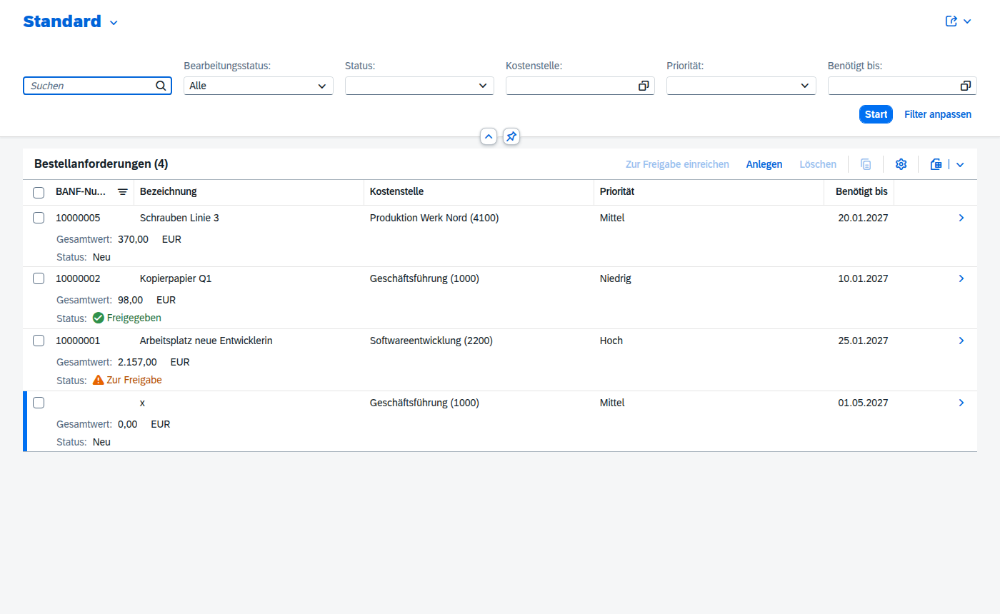
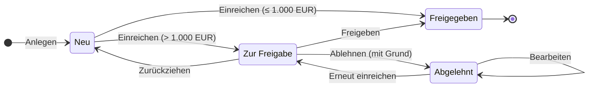
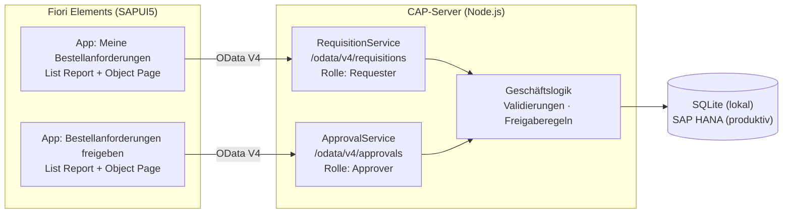
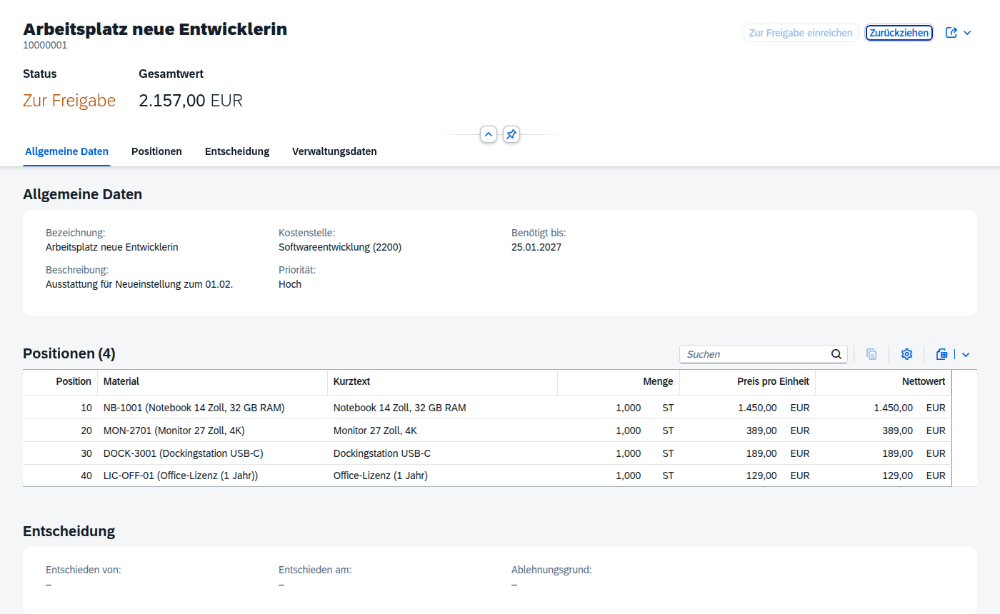
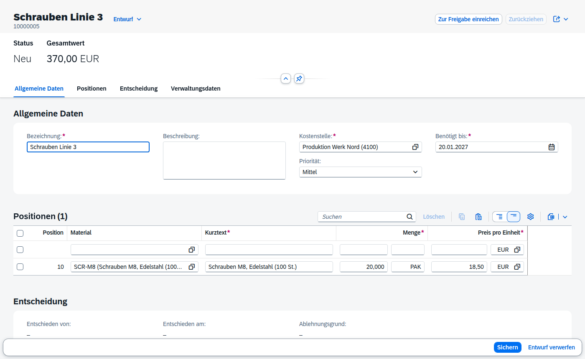
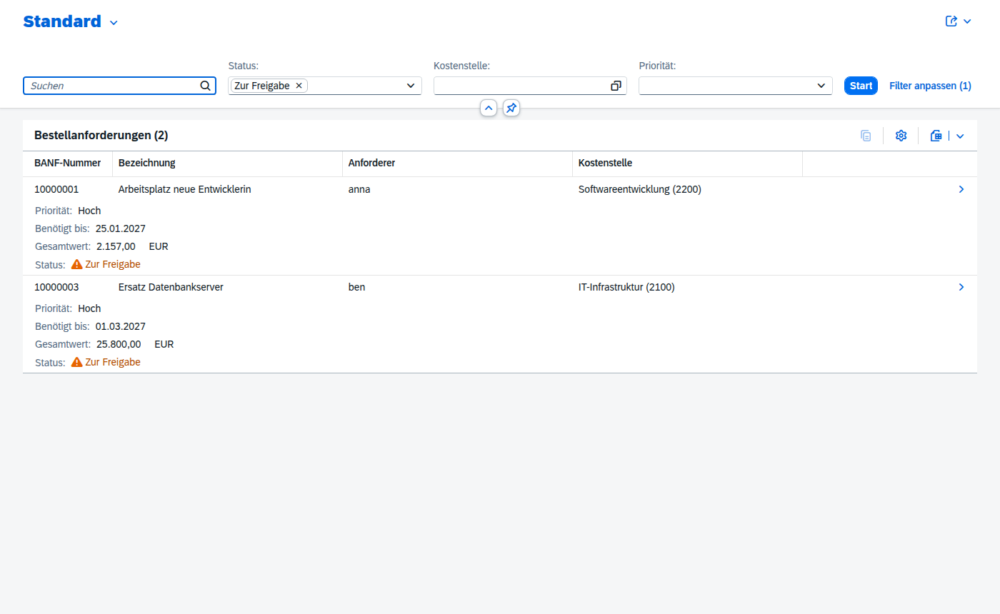
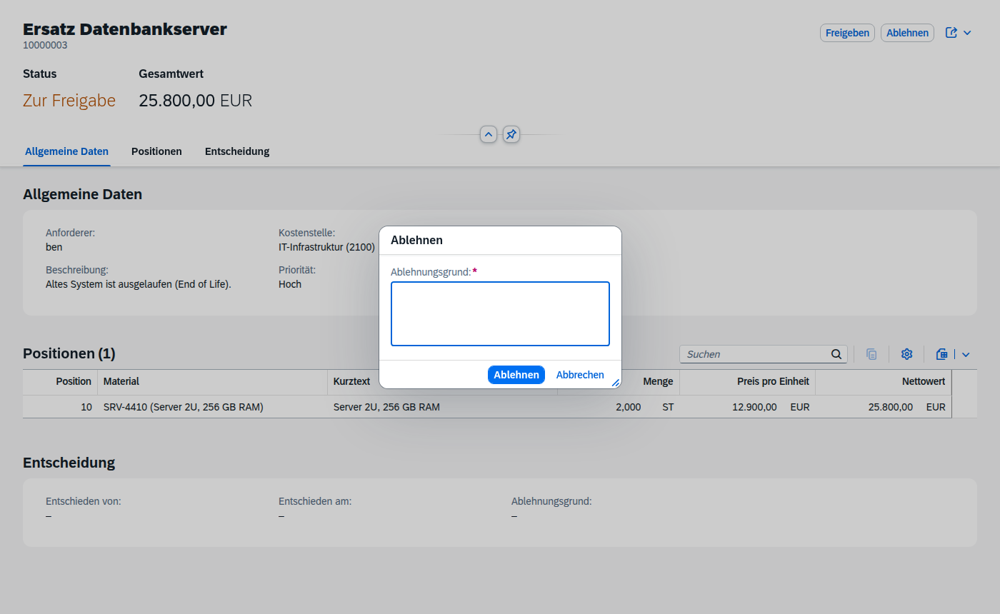

# Bestellanforderung mit Freigabeprozess

**SAP CAP (Node.js) · Fiori Elements · OData V4 · Draft · Rollen & Berechtigungen**

[](https://github.com/macleodc708/sap-cap-purchase-requisition/actions/workflows/ci.yml)

Eine kleine, vollständige Geschäftsanwendung nach dem Vorbild der **Bestellanforderung (BANF)** in SAP MM:
Mitarbeitende erfassen Bedarfe mit Positionen, reichen sie zur Freigabe ein, und Genehmiger geben frei oder lehnen ab.
Umgesetzt mit dem **SAP Cloud Application Programming Model (CAP)** und zwei **Fiori-Elements-Apps**, also dem Technologie-Stack,
den SAP für Erweiterungen „neben“ S/4HANA (*Side-by-Side*, *Clean Core*) auf der SAP BTP empfiehlt.

> *English summary:* A purchase requisition app with a multi-level approval workflow, built with SAP CAP (Node.js),
> OData V4 and two SAP Fiori elements apps. It features draft handling, role-based and instance-based authorization,
> segregation of duties, value-based approval limits, server-side validations, i18n (DE/EN), and automated tests in CI.



---

## Funktionen

| Bereich | Umsetzung |
|---|---|
| **Erfassen mit Entwurf** | Draft-Handling: Änderungen werden zwischengespeichert und erst mit „Sichern“ aktiv. |
| **Positionen** | Materialauswahl über Wertehilfe. Kurztext, Einheit und Preis werden aus dem Materialstamm übernommen. Positionsnummern 10, 20, 30 … |
| **Automatische Werte** | BANF-Nummer (Nummernkreis ab 10000001), Nettowert je Position, Gesamtwert (live im Entwurf über *Side Effects*) |
| **Prüfungen** | Pflichtfelder, „Benötigt bis“ nicht in der Vergangenheit, Menge > 0, Preis ≥ 0, mindestens eine Position vor dem Einreichen |
| **Freigabestrategie** | bis **1.000 EUR** automatische Freigabe · bis **25.000 EUR** jeder Genehmiger · darüber nur die **Einkaufsleitung** |
| **Vier-Augen-Prinzip** | Niemand kann die eigene Anforderung freigeben oder ablehnen, auch wenn er beide Rollen hat. |
| **Statussteuerung** | Neu → Zur Freigabe → Freigegeben / Abgelehnt. Bearbeiten, Löschen und Aktionen werden je nach Status ein- oder ausgeblendet. |
| **Berechtigungen** | Rollen pro Service (`@requires`), Anforderer sehen nur eigene Belege (`@restrict … where createdBy = $user`) |
| **Nebenläufigkeit** | Eine Entscheidung wird nur gespeichert, wenn der Status noch „Zur Freigabe“ ist. So wird nicht doppelt entschieden. |
| **Mehrsprachig** | Alle Texte, Statuswerte und Meldungen auf Deutsch und Englisch |
| **Tests & CI** | 17 automatisierte API-Tests mit `cds.test`, Lint und Tests laufen bei jedem Push über GitHub Actions. |

## Prozess



## Architektur



Die Oberflächen enthalten **keinen eigenen JavaScript-Code für die Fachlogik**. Sie werden vollständig aus
CDS-Annotationen erzeugt (`app/*/annotations.cds`). Die Fachlogik liegt ausschließlich im Backend.

## Screenshots

| | |
|---|---|
| **Detailansicht** mit Positionen und Status | **Bearbeiten im Entwurf** mit Wertehilfen |
|  |  |
| **Freigabe-App** mit offenen Anforderungen | **Ablehnen** mit Pflicht-Begründung |
|  |  |

## Starten

Voraussetzung: **Node.js 22** oder neuer.

```bash
git clone https://github.com/macleodc708/sap-cap-purchase-requisition.git
cd sap-cap-purchase-requisition
npm install
npm run watch
```

Dann im Browser **http://localhost:4004/launchpad.html** öffnen.

### Demo-Benutzer (Passwort jeweils `demo`)

| Benutzer | Rollen | Darf |
|---|---|---|
| `anna` | Requester | eigene Bestellanforderungen anlegen und einreichen |
| `ben` | Requester, Approver | anlegen und freigeben, aber nie die eigenen (Vier-Augen-Prinzip) |
| `carla` | Approver | freigeben bis 25.000 EUR |
| `david` | Approver, PurchasingManager | freigeben ohne Wertgrenze |

> Der Browser merkt sich die Anmeldung. Für einen Benutzerwechsel am einfachsten ein privates Fenster verwenden.

Die Wertgrenzen sind konfigurierbar in `package.json` unter `cds.requisition`.

## Tests

```bash
npm test      # 17 API-Tests (Anlegen, Validierungen, Berechtigungen, Freigabeprozess)
npm run lint  # ESLint
```

## Projektstruktur

```
db/
  schema.cds              Datenmodell: BANF-Kopf, Positionen, Kostenstellen, Materialien, Status
  data/                   Beispieldaten (CSV)
srv/
  requisition-service.*   Service + Logik für Anforderer (Draft, Nummernvergabe, Einreichen)
  approval-service.*      Service + Logik für Genehmiger (Freigabestrategie, Vier-Augen-Prinzip)
app/
  common.cds              gemeinsame Annotationen (Texte, Wertehilfen)
  requisitions/           Fiori-App „Meine Bestellanforderungen“
  approvals/              Fiori-App „Bestellanforderungen freigeben“
  launchpad.html          Einstiegsseite für die Demo
_i18n/                    Texte und Meldungen (DE/EN)
test/                     automatisierte Tests
```

## Bewusste Vereinfachungen und nächste Schritte

Das Projekt ist eine Demo und keine produktive Anwendung. Für den Produktivbetrieb wären die nächsten Schritte:

- **Authentifizierung** über SAP Identity Services (XSUAA / IAS) statt Demo-Benutzern
- **SAP HANA Cloud** statt SQLite, Deployment auf die **SAP BTP** (Cloud Foundry oder Kyma)
- **Nummernvergabe** über eine Datenbanksequenz statt `max() + 1` (wegen gleichzeitiger Zugriffe)
- **Anbindung an S/4HANA**: Kostenstellen und Materialien aus den Standard-APIs lesen, freigegebene BANFen als Bestellanforderung in S/4HANA anlegen
- **SAP Build Process Automation** für mehrstufige Workflows mit Vertretungsregeln

Derselbe Prozess in ABAP RAP: [sap-rap-purchase-requisition](https://github.com/macleodc708/sap-rap-purchase-requisition)

Verwandtes Projekt: [Lieferantenbewertung als Side-by-Side-Erweiterung zu SAP S/4HANA](https://github.com/macleodc708/sap-cap-supplier-evaluation)

## Hinweis

Entwickelt mit Unterstützung von KI (Claude von Anthropic).

## Lizenz

[MIT](LICENSE)
